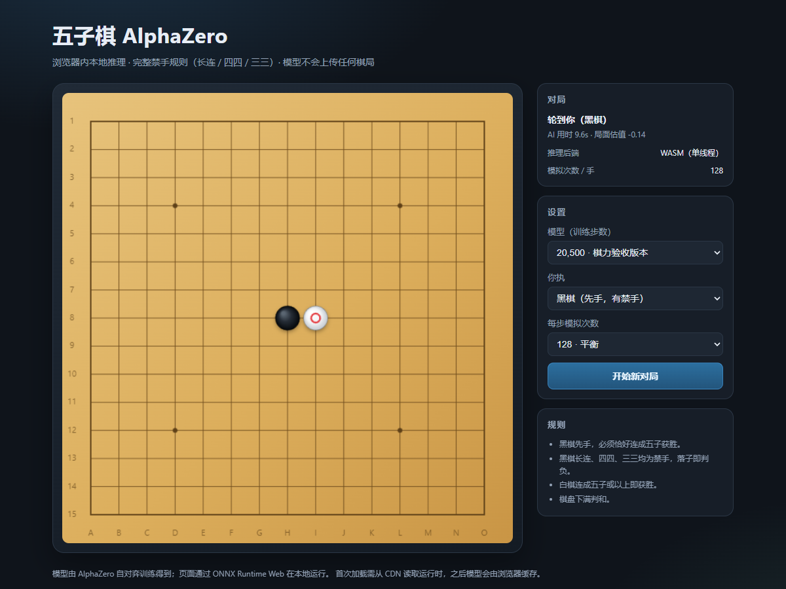

# 五子棋 AlphaZero（Renju 禁手规则）

一个从零开始、只靠自我对弈训练出来的 15×15 五子棋 AI。完整实现 RIF 禁手规则，训练使用 26 种 RIF 平衡开局 + 20% 自由开局；仓库同时提供最终权重、训练记录和可直接在浏览器里下的静态对战页。

<p align="center">
  
</p>

## 结论

- **第 20,500 步是唯一完成 100 局验收的基准模型**：对 greedy 基准 **87 胜 1 和 12 负（得分率 87.5%）**，对随机初始模型 **100 胜 0 和 0 负**。
- **第 27,702 步是训练结束时的最终状态**：从 `training_state.db` 导出，没有再做 100 局验收。
- **两个模型的直接对战**：在 10 个 RIF 开局、双方交换执子、共 20 局、32 次模拟的对比中，**27,702 以 15 胜 5 负领先**；20,500 的得分率只有 25%。
- **怎么选**：需要可引用的 100 局验收数据时用 **20,500**；想用训练最终状态、且接受“只有 20 局直接对战”的证据时用 **27,702**。
- **在线试玩**：<https://datou.github.io/Datou-gomoku-alphazero/>。模型在浏览器本地推理，不上传棋局，不需要后端。

## 关键结果

### 训练进度：从不会挡四到超过 greedy

训练从随机初始化开始，共 **27,702 步**，约 **29 小时**（单张 RTX 4090，32 个自对弈 worker，每步 256 次 MCTS 模拟）。

评估协议是 4 个固定开局、双方交换执子、共 8 局，128 次模拟：

| 训练步数 | 对 greedy 基准（8 局） | 对随机初始模型（8 局） |
|---:|---:|---:|
| 2,500 | 0 胜 0 和 8 负 | 8 胜 0 和 0 负 |
| 5,000 | 0 胜 0 和 8 负 | 8 胜 0 和 0 负 |
| 10,500 | 6 胜 0 和 2 负（75%） | 8 胜 0 和 0 负 |
| 15,500 | 7 胜 0 和 1 负（87.5%） | 8 胜 0 和 0 负 |
| **20,500** | **8 胜 0 和 0 负（100%）** | **8 胜 0 和 0 负（100%）** |

前 5,000 步能赢随机模型，但完全打不过 greedy；第 10,500 步第一次超过 50%；第 15,500 步只差一局；第 20,500 步达到目标。

### 100 局验收：87.5% 对 greedy

第 20,500 步模型使用冻结的 50 个开局，每个开局双方各执一次，共 100 局，每步 256 次模拟：

| 对手 | 胜 | 和 | 负 | 得分率 | 95% 配对 bootstrap 区间 |
|---|---:|---:|---:|---:|---:|
| greedy 基准 | 87 | 1 | 12 | **87.5%** | **[81.5%, 93.0%]** |
| 随机初始模型 | 100 | 0 | 0 | **100%** | — |

黑白两侧都通过了验收：黑棋 43 胜 1 和 6 负（87%），白棋 44 胜 0 和 6 负（88%）。

### 20,500 vs 27,702：27,702 以 15:5 领先

用 10 个 RIF 开局，每个开局双方各执一次，共 20 局；固定 32 次模拟，关闭根节点噪声和温度采样，因此同一开局可复现。A = 20,500，B = 27,702。

| A（20,500）视角 | 胜 | 和 | 负 | 得分率 |
|---|---:|---:|---:|---:|
| 执黑 | 3 | 0 | 7 | 30% |
| 执白 | 2 | 0 | 8 | 20% |
| **合计** | **5** | **0** | **15** | **25%** |

B（27,702）取得 **15 胜 5 负**。多训练 7,202 步带来的提升是明确的，但这是 20 局、32 次模拟的快速对比，不是 100 局验收；不能据此推断 27,702 在 128/256 次模拟下也一定更强。

## 怎么用

### 在线试玩

打开：<https://datou.github.io/Datou-gomoku-alphazero/>

- 可选择 **20,500（验收版）** 或 **27,702（最终训练版）**；
- 执黑（先手，有禁手）或执白；
- 64 / 128 / 256 次 MCTS 模拟；
- 优先 WebGPU，不可用时回退单线程 WASM；
- 加载模型显示真实下载进度；点击“开始新对局”会先确认；轮到你时状态栏有呼吸高亮。

### 加载 PyTorch 权重

```python
import torch
from config import config
from network import GomokuNetEZ

model = GomokuNetEZ(config)
state = torch.load("weights/alphazero_20500.pt", map_location="cpu", weights_only=True)
model.load_state_dict(state, strict=True)
model.eval()
```

### 本地运行训练

```bash
python -m venv .venv
pip install -r requirements.txt
python main.py
```

默认输出到 `outputs/renju/`。常用环境变量：

| 变量 | 说明 |
|---|---|
| `GOMOKU_OUTPUT_DIR` | 输出目录 |
| `GOMOKU_NUM_WORKERS` | 自对弈 worker 数（默认 32） |
| `GOMOKU_RULESET` | `renju` 或 `freestyle` |
| `GOMOKU_SELFPLAY_OPENINGS` | `rif26` 启用 26 种 RIF 开局 |
| `GOMOKU_SELFPLAY_FREE_RATIO` | 自由开局比例（默认 0.2） |
| `GOMOKU_TRAIN_SECONDS` | 训练时间上限（秒，0 表示不限） |
| `GOMOKU_SAVE_INTERVAL` | 检查点间隔（默认 1000 步） |
| `GOMOKU_PROFILE=smoke` | 小规模端到端自检 |

在输出目录放一个 `STOP` 文件，主进程会优雅保存并退出。

## 训练方法

### 规则

- 15×15 棋盘，黑先。
- 黑棋必须**恰好**连成五子；长连（六子及以上）判负。
- 黑棋四四、三三为禁手，落子即判负。
- 白棋连成五子或以上即获胜。
- 棋盘下满判和。

禁手判定在 `renju_rules.py` 中递归实现：一个“三”只有在它的两个直四延伸点都能形成合法五连时才算真三；延伸点自身是禁手时，这个三不算数。这样能处理假三、四四解禁、长连解禁等边界。

### 网络

- 输入：3×15×15 的规范平面（当前行动方棋子、对手棋子、最后一手）。
- 主干：8 个 SE-ResBlock，128 通道。
- 策略头：225 维落子 logits。
- 价值头：3 个支撑点 `{-1, 0, +1}` 的分布，推理时取期望。
- 辅助头：剩余步数回归，训练权重 0.05。

### 搜索

- AlphaZero PUCT，`c_puct = 2.0`。
- 每步 256 次模拟；只搜索已有棋子附近半径 2 的候选点。
- 根节点 Dirichlet 噪声只加在先验最高的 32 个着法上，`alpha = 0.3`，`epsilon = 0.25`。
- 前 8 手按访问次数分布采样，之后取访问次数最多的着法。
- 终局节点不展开，值按“轮到走棋一方”的胜负记录，回溯跨边变号。

### 自我对弈与开局

- 每局从 26 种 RIF 三手开局中随机选一种，并随机做 8 种旋转/镜像。
- 20% 的自我对弈局只固定黑棋天元，从自由开局开始。
- 开局三手作为棋谱着法记录，策略目标为 one-hot；从白棋第四手开始由 MCTS 搜索。
- 不使用强制成五或强制挡四的战术覆盖。

### 优化器与回放

- Adam，学习率 `2e-4`，余弦衰减到 `1e-7`（200,000 步）。
- 物理 batch 128；每个新产生的局面最多被采样 8 次。
- 回放缓冲区 100,000 个样本；目标网络软更新 `tau = 0.995`。
- 价值目标始终是最终胜负 `z`，不从模型自身价值 bootstrap。
- 数据增强：随机旋转 0/90/180/270 度 + 水平翻转，策略和动作索引同步变换。

## 权重

| 文件 | 说明 |
|---|---|
| [`weights/alphazero_20500.pt`](weights/alphazero_20500.pt) | **验收基准**。第 20,500 步，通过 100 局验收。 |
| [`weights/alphazero_27702.pt`](weights/alphazero_27702.pt) | **最终权重**。第 27,702 步；直接对战 15:5 领先 20,500，未做 100 局验收。 |
| [`weights/initial_model.pt`](weights/initial_model.pt) | 随机初始化参考模型，只用于评估基线。 |

每个 `.pt` 旁边都有同名 `.json`，记录棋盘大小、网络结构、规则和搜索参数。浏览器使用的是对应导出的 ONNX：

- `docs/models/alphazero_20500.onnx`
- `docs/models/alphazero_27702.onnx`

重新导出：

```bash
python tools/export_onnx.py \
  --checkpoint weights/alphazero_20500.pt \
  --output docs/models/alphazero_20500.onnx
```

## 复现与评估

### 8 局进度评估

```bash
python tools/evaluate_progress.py \
  --checkpoint weights/alphazero_20500.pt \
  --sims 128 --pairs 4
```

### 100 局验收

```bash
python tools/evaluate_progress.py \
  --checkpoint weights/alphazero_20500.pt \
  --sims 256 --suite confirmation

python tools/evaluate_progress.py \
  --checkpoint weights/alphazero_20500.pt \
  --sims 256 --suite confirmation --opponent initial
```

原始结果（含每局完整着法）在 `training/evaluations/`。

### 两个模型直接对战

```bash
python tools/match_models.py \
  --a weights/alphazero_20500.pt \
  --b weights/alphazero_27702.pt \
  --openings 10 --sims 32 --device cpu
```

使用 10 个 RIF 开局，每个开局双方各执一次，共 20 局；搜索是确定性的（无根噪声、无温度采样），保证同一开局可复现。原始结果见 [`training/evaluations/match_20500_vs_27702_sims32_openings10.json`](training/evaluations/match_20500_vs_27702_sims32_openings10.json)。

### 测试

```bash
python -m unittest discover -s tests -v
node tests/test_web_mcts.js
```

Python 测试覆盖禁手边界、PUCT 符号回溯、价值目标、数据切片、SQLite 状态恢复、RIF 开局合法性和 ONNX 推理一致性；`node tests/test_web_mcts.js` 检查浏览器 MCTS 在只有一个成五点时必须落子成五。

## 浏览器对战页

页面完全静态，运行时和模型都在 `docs/` 内：

- ONNX Runtime Web 1.20.1 放在 `docs/vendor/`，不依赖外部 CDN；
- 模型输入 `obs: float32[1,3,15,15]`，输出 policy/value/moves_left；
- 优先 WebGPU，失败回退单线程 WASM；
- 模型加载使用 `fetch` 流式读取，显示真实字节进度；
- 规则、PUCT 和 UI 都是纯 JavaScript，没有后端。

浏览器版规则与 Python 版做过逐点对比：1,609 个随机局面点、8,000 个密集局面点、15,000 个定向三三局面，禁手原因完全一致；候选着法和终局判定在 264 个对局快照上一致。

浏览器 MCTS 的值始终以“当前行棋方”视角存储，回溯跨边变号。因此一步成五在叶节点是终局 `+1`，父节点会记录为对自己有利；128 次模拟已经足够发现一步成五。256 次模拟主要提升更深的战术和防守，不是发现直接成五的必要条件。

本地预览：

```bash
python tools/serve_docs.py
# 打开 http://127.0.0.1:8000/
```

> 某些 Python 版本的 `http.server` 会把 `.mjs` 当成 `text/plain`，导致 ONNX Runtime 模块加载失败；`tools/serve_docs.py` 已修正 MIME 类型。

## 代码结构

```text
.
├── main.py                 # 训练入口
├── config.py               # 超参数与运行开关
├── game.py                 # 棋盘、合法着法、终局判定
├── renju_rules.py          # 禁手判定（递归真三检测）
├── rif_openings.py         # 26 种 RIF 开局与对称变换
├── network.py              # SE-ResNet、策略头、价值头
├── mcts.py                 # AlphaZero PUCT
├── loss.py                 # policy / value / moves-left 损失
├── workers.py              # 自对弈、推理服务、DataLoader、Trainer
├── db_manager.py           # SQLite 回放与训练状态
├── inference_backend.py    # 批量推理、fp16、CUDA Graph
├── shared_inference.py     # 共享内存推理传输
├── training_runtime.py     # 运行锁、STOP、预算和断点恢复
├── docs/                   # 静态对战页、ONNX 模型和运行时
├── weights/                # PyTorch 权重
├── training/               # 训练日志、配置、评估原始结果
├── tools/                  # 评估、模型对战、ONNX 导出、本地服务器
└── tests/                  # Python 测试 + 浏览器 MCTS 回归测试
```

## 已知限制

- 只支持 15×15 五子棋和 RIF 禁手规则，不支持指定开局、五手两打等其他比赛变体。
- 第 27,702 步模型没有做 100 局验收；直接对战 15:5 说明它更强，但样本只有 20 局、32 次模拟，不能替代 100 局验收。
- 两个模型的直接对战是 20 局、32 次模拟的固定开局测试，样本量有限，不等同于 100 局验收。
- MCTS 是近似搜索：128 次能发现直接成五，但更深的杀棋、防守和复杂交换仍可能被漏掉；256 次会更稳，但不是穷举。
- 浏览器端 MCTS 在主线程运行，256 次模拟时页面会短暂无响应；CPU/WASM 明显慢于 WebGPU。
- 训练使用单机 32 worker，完整复现 29 小时需要相近的 GPU 和 CPU 资源；小规模复现可用 `GOMOKU_PROFILE=smoke`。
